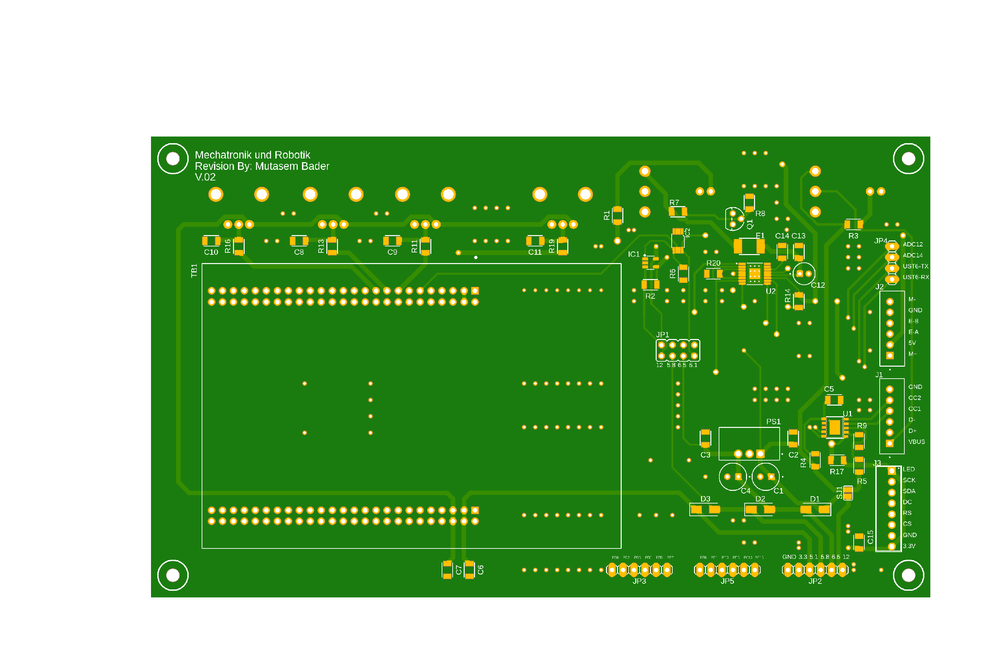
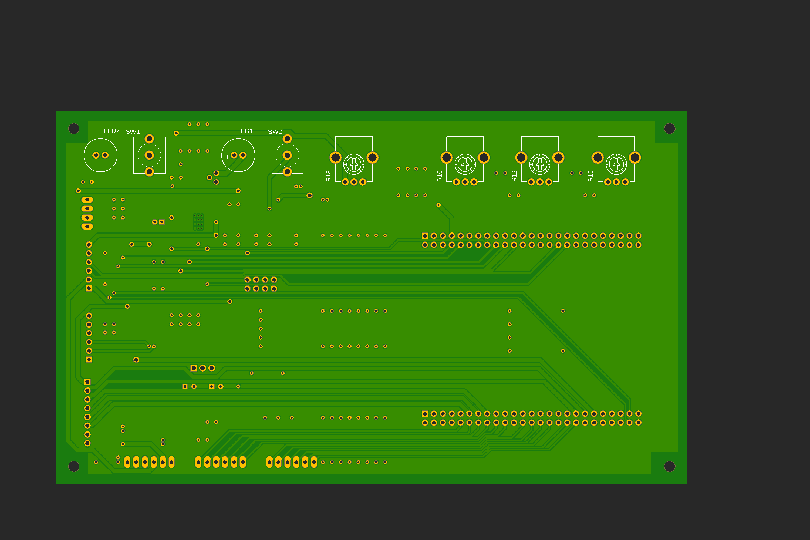

# PID Demonstrator: PCB for an STM32F4 Control Loop

A custom PCB for a PID control demonstrator. An STM32F4-Discovery board controls a DC motor, and the gains Kp, Ki and Kd are set with potentiometers on the board. This repository contains the hardware only: schematic, layout and bill of materials.

Team project in the master's course *Simulation and Control* at Frankfurt UAS (summer semester 2025). The project is finished.

My part was the hardware: concept, schematic, two-layer layout, the power supply with USB-C Power Delivery and the integration of the STM32F4 board. I also supported the PID tuning with the MATLAB PID Tuner.

## Project status

The first board was assembled and tested, and it ran in the demonstrator setup. The tests showed several hardware errors, which I corrected in a second revision. That revision was designed but not manufactured, because the project ended at that point.

## System Architecture

```
┌────────────────────────────────────────────────────┐
│                  PID Demonstrator                  │
│                                                    │
│  Setpoint ──► [PID Controller] ──► [DC Motor]      │
│  (Pot)        STM32F4-Discovery    + H-Bridge      │
│                     ▲                   │          │
│                     └─── [Sensor] ◄─────┘          │
│                          (Pot / Encoder)           │
│                                                    │
│  Display      ←  angle / speed / error             │
│  Serial port  ←  live data for plotting            │
└────────────────────────────────────────────────────┘
```

Third-party reference video (not my work): ["PID demo" by Voltix Electronics Lab on YouTube](https://youtu.be/qKy98Cbcltw)

## PCB Design

Design and layout of the custom PCB that integrates all hardware components on a single board.

### PCB Features

| Block | Components |
|---|---|
| Power management | USB-C Power Delivery sink (CH224K) for 12 V from a power bank, DC/DC module TSR 3-2465N for 6.5 V, diode drops for 5.8 V and 5.1 V; 3.3 V is supplied by the STM32F4-Discovery board |
| Motor current sensing | Shunt resistor + INA138 current monitor |
| Motor driver | DRV8848 dual H-bridge |
| Gain potentiometers | Three 10 kΩ rotary potentiometers for Kp, Ki, Kd |
| Setpoint potentiometer | One 10 kΩ rotary potentiometer |
| Display interface | SPI header for a 128×160 ST7735 TFT display |
| MCU interface | Pin header for STM32F4-Discovery board |
| Serial output | UART header for live data streaming |

### PCB Layout

The layout shown below is the **revised version (v2)**, which was designed but never manufactured. Its silkscreen reads "V.03" by mistake; it is not a third revision.

| Layer | Image |
|---|---|
| Top |  |
| Bottom |  |

### Schematic


### PCB Design File

See [`pcb-design.fbrd`](pcb-design.fbrd) (Fusion 360 Electronics board file; it contains EAGLE board data).

### Bill of Materials

[`bill-of-materials.xlsx`](bill-of-materials.xlsx) lists the parts with supplier part numbers and prices (Reichelt/Mouser, as of 03.06.2026) and refers to schematic v65. The reference designators follow that schematic and can differ from the revised board file (for example `PS1` for the DC/DC module instead of `U2`).

## References

- [DRV8848 datasheet](https://www.ti.com/lit/ds/symlink/drv8848.pdf) (Texas Instruments)
- [INA138 datasheet](https://www.ti.com/lit/ds/symlink/ina138.pdf) (Texas Instruments)

## License

Copyright (c) 2026 Mutasem Bader. All rights reserved.  
Viewing is permitted. Copying, modifying, or submitting as own work is strictly prohibited.  
See [LICENSE](LICENSE) for details.
